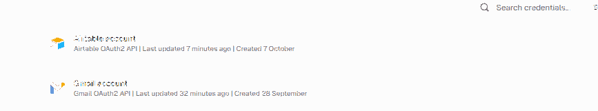

# Checkpoint 4 — IdeI SmartDesk AI
## Integraciones avanzadas | Coderhouse IA Avanzada

**Autor:** Matías Silva  
**Workflow n8n:** https://masilva.app.n8n.cloud/workflow/zEqwm7nIX1tCliOA  
**Archivo entregable:** [checkpoint4_matias_silva.json](./checkpoint4_matias_silva.json)  
**Estado:** flujo creado y probado mediante ejecuciones manuales; *no publicado como servicio de monitoreo permanente* para impedir procesar correos personales automáticamente.

## Descripción del proyecto

Evolución incremental de IdeI SmartDesk AI (M1 → M2 Manager/Workers → M3 memoria persistente → M4 conexiones). **Se conservaron intactos los workflows de los checkpoints anteriores**. En M4 se añadió una rama autónoma de recepción de correos con control anti-bucles, validación y recorte de payload, lookup de contactos CRM, generación de un borrador sujeto a revisión humana y notificación operativa a Slack.

### Herramientas del negocio y OAuth2

| Rol | Conector nativo en n8n | Credencial asignada | Operación autorizada |
|---|---|---|---|
| CRM de contactos | Airtable | `Airtable account` — OAuth2 | Search → Update o Create de registro en `Contactos_Administrativos_M4` |
| Correo de consultas | Gmail | `Gmail account` — OAuth2 | Gmail Trigger de entrada y **Draft: Create** (NO Send) |
| Canal de operaciones | Slack | `Slack account` — OAuth2 | Message: Post en `#idei-smartdesk-operaciones` |

**Vinculaciones reales comprobadas:** Airtable creó y actualizó un contacto; Gmail guardó dos borradores; Slack publicó dos avisos. Las referencias de credenciales (ID/nombre) están presentes en el JSON exportado, pero **no** se incluyen claves, tokens ni contraseñas.

**Importante para mínimo privilegio:** los *nodos* están limitados a las operaciones indicadas; el alcance exacto de los permisos OAuth (*scopes* concedidos en cada proveedor) se debe revisar en el panel de credenciales, porque las herramientas usadas no exponen esos permisos de forma verificable.

### Evidencia real de Credentials en n8n

Captura auténtica aportada desde el panel **Personal → Credentials** de n8n. Se observan **Airtable account**, **Gmail account** y **Slack account** identificadas como conexiones **OAuth2 API**, con sus referencias de uso. La imagen preserva únicamente el listado de credenciales, sin mostrar claves privadas, tokens ni pantallas de edición.



[Ver captura original incorporada al repositorio](evidencias/credentials-n8n.png)

**Alcance de la prueba:** acredita la existencia de las tres credenciales OAuth2 y, junto con los tests #84–#85, su operatividad para las acciones configuradas. No acredita por sí sola el listado de scopes OAuth concedidos por cada proveedor, que debe revisarse por separado si el docente lo solicita.

## Arquitectura

```text
[M3 Chat Trigger] → [Memoria Airtable por Session_ID] → [Manager AI]
                   → [Workers M2] → [Resumen si >5] → [Upsert memoria]

[M4 Gmail Trigger] → [IF: anti auto-reply]
                Sí (válido) → [Set: From, Subject, snippet, ID]
                                      ↓
                               [IF: email/ID válidos]
                                      ↓
                               [AI Agent: redacta]
                                      ↓
                               [Set: datos mínimos]
                                      ↓
                               [Airtable CRM Lookup por Email]
                                      ↓
                            [IF: contacto ya existe]
                                /                \
                           Update              Create
                                \                /
                                [Gmail Create Draft]
                                        ↓
                               [Set: Slack payload]
                                        ↓
                         [Slack Post: operaciones]
                                        ↓
                               [Fin / HITL]
                No (auto reply) → [Ignorado sin efectos]
                No (payload inválido) → [Bloqueado: 400]
```

### Cuatro compuertas de la rúbrica

1. **Anti auto-reply:** inmediatamente después del Gmail Trigger. Detecta `Auto-reply`, `Out of office`, `Undeliverable`, `Automatic reply`, `no-reply@`, `mailer-daemon`, `postmaster` y correos enviados desde la cuenta del operador; corta la rama y no escribe, notifica ni crea borradores.
2. **Lookup antes de Create:** `M4 08 | Airtable CRM Lookup` busca Email con fórmula de igualdad exacta. `M4 09 | IF contacto existente` separa Update de Create. El correo se normaliza a minúsculas; así se evita crear un registro repetido en búsquedas normales. La unicidad bajo concurrencia alta requeriría una clave única adicional.
3. **Human-in-the-loop:** `M4 11 | Gmail Create Draft HITL` usa recurso `draft` y operación `create`. **No existe un nodo Send en la rama M4.** La persona encargada debe revisar y enviar manualmente el borrador desde Gmail.
4. **Set + validación previa:** `M4 03` conserva solo email, asunto, snippet de 800 caracteres, IDs; `M4 04` bloquea email inválido o ID ausente antes de Airtable/Gmail. `M4 12` elimina cuerpo, adjuntos y metadatos antes de Slack; envía únicamente estado, asunto limitado e ID de borrador.

### Principio de mínima exposición

- Gmail Trigger consulta únicamente mensajes no leídos recientes con `subject:IdeI`; excluye bandejas Enviados, Borradores y Promociones.
- Gmail Trigger usa `simple:true`, sin descargar adjuntos ni HTML.
- El CRM es una tabla específica de contactos, separada de `Memoria_Sesiones`.
- Slack notifica solo metadatos mínimos al canal dedicado `#idei-smartdesk-operaciones`. No transfiere el cuerpo del correo ni el texto del borrador.
- El workflow M4 se conserva **sin activar** para evitar procesamiento automático de correos reales hasta la aprobación de uso en producción.

## Evidencia de tests reales

| Ejecución | Escenario | Resultado |
|---|---|---|
| **#83** | Auto-reply desde `no-reply@` | La compuerta lo cortó. No ejecutó CRM, Gmail Draft ni Slack |
| **#84** | Consulta válida, primer contacto | AI redactó, CRM **Create**, Gmail **Create Draft**, Slack **Post**, ejecución exitosa |
| **#85** | Segunda consulta con el mismo Email | CRM **Lookup → Update** sobre el **mismo record_id**; nuevo borrador y aviso Slack |
| **#86** | Remitente con email inválido | IF detuvo el proceso, previniendo error 400 antes de integraciones |
| **#88** | Regresión del chat Manager-Worker M3 | Chat → Airtable sesión nueva → Worker redacción → actualización memoria, sin enviar correos |

Las pruebas #83–#86 se efectuaron mediante un **Chat Trigger simulador temporal**, conectado a los mismos controles y conectores reales. Se retiraron sus dos nodos tras la validación para dejar un workflow entregable de **50 nodos**. Esas pruebas no equivalen a activar el polling real de Gmail, que permanece desactivado.

### Enlaces de verificación interna

- [Workflow M4 en n8n](https://masilva.app.n8n.cloud/workflow/zEqwm7nIX1tCliOA)
- [Base CRM / memoria en Airtable](https://airtable.com/appjdAFjKv6rxnyou)
- [Canal del equipo en Slack](https://app.slack.com/client/T0C58FS0U76/C0CFWMBSPNV)
- [Borradores de Gmail](https://mail.google.com/mail/u/0/#drafts)

## Importar el JSON

Desde n8n: **Workflows → Import from File** y seleccionar [checkpoint4_matias_silva.json](./checkpoint4_matias_silva.json). Tras importar, asociar las credenciales OAuth2 de Airtable, Gmail y Slack y verificar los IDs de la base, tabla, canal de Slack y sub-workflows. Los IDs de los dos Workers M2 pertenecen a la instancia original y se deben ajustar en otra instancia.

El archivo contiene nodos, conexiones, expresiones, parámetros y referencias a credenciales; **no contiene tokens secretos**. Nunca publicar valores privados de OAuth ni datos reales de terceros en GitHub.
