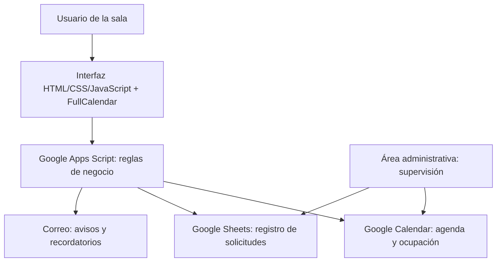

# Sala 13 | Sistema de reservas y automatización administrativa

**Caso real de transformación digital en la Universidad Nacional de San Juan (Argentina)**

> De coordinar reuniones mediante comunicaciones dispersas a disponer de una agenda digital con disponibilidad visible, solicitudes autogestionadas y seguimiento automatizado.

**Rol:** Matías Andrés Silva — Jefe del Área Administrativa, Instituto de Informática (IdeI), Facultad de Ciencias Exactas, Físicas y Naturales, Universidad Nacional de San Juan.  
**Tipo de proyecto:** solución institucional implementada en el ámbito laboral.  
**Tecnologías:** JavaScript, Google Apps Script, HTML, CSS, Google Calendar, Google Sheets, Gmail / MailApp, FullCalendar.  
**Metodología:** análisis de procesos, diseño funcional, desarrollo iterativo y programación asistida por IA.

[**Ver la aplicación institucional**](https://tinyurl.com/sala13idei) · [Código backend](src/Code.gs) · [Interfaz web](src/Index.html) · [Arquitectura](docs/arquitectura.md) · [Caso de negocio](docs/caso-de-negocio.md)

## 1. El problema: cuando reservar una sala se convierte en trabajo administrativo

En una oficina universitaria, coordinar el uso de una sala compartida demandaba múltiples intercambios para consultar disponibilidad, solicitar fechas, registrar cambios y confirmar el uso. El proceso dependía de la intervención de personal administrativo y podía provocar pedidos superpuestos, demoras de respuesta y errores de comunicación.

**Pregunta de diseño:** ¿cómo convertir una tarea repetitiva en un servicio digital simple, con reglas claras, trazabilidad y supervisión administrativa?

## 2. Mi intervención

Desde mi función administrativa identifiqué el cuello de botella, traduje las necesidades de la oficina en requisitos, diseñé el circuito de reservas y desarrollé e implementé una herramienta integrada al ecosistema de Google Workspace.

El trabajo combinó **conocimiento del proceso de negocio + diseño de experiencia de usuario + desarrollo asistido por IA + automatización**. La IA se utilizó como apoyo en la construcción y mejora del software; **no se afirma que el sistema en ejecución utilice un modelo de IA**.

## 3. La solución

Una aplicación web de reservas para la Sala 13, con calendario visual y reglas de disponibilidad.

| Necesidad de la oficina | Solución incorporada |
|---|---|
| Consultar horarios sin intercambiar mensajes | Agenda visual de disponibilidad |
| Reservar un día o varios | Selección por fechas y rangos horarios, con días consecutivos o separados |
| Repetir reuniones periódicas | Solicitudes con recurrencia semanal |
| Evitar conflictos | Validaciones de ocupación, fechas y horarios |
| Registrar solicitudes | Google Sheets como registro operativo y Calendar como agenda |
| Evitar reservas sin seguimiento | Avisos por correo y flujo de confirmación previo |
| Gestionar cambios y bajas | Acciones por código y flujos de actualización/cancelación |
| Ajustarse a la actividad institucional | Reglas de días no disponibles, horarios y capacidad |

### Recorrido de una reserva

1. La persona consulta el calendario y elige fecha(s) y horario(s).
2. Completa datos de la solicitud y, si corresponde, la recurrencia.
3. El sistema valida las reglas y registra la operación.
4. Se integran los eventos con la agenda y se envían comunicaciones.
5. El circuito de recordatorios permite gestionar la confirmación antes del uso.

La herramienta conserva **intervención humana** para administración, seguimiento y excepciones.

## 4. Arquitectura de la solución

La implementación usa tecnologías accesibles en un entorno universitario y evita incorporar infraestructura de servidor propia para este caso de uso. Los identificadores y credenciales de producción **no están incluidos** en este repositorio.

## 5. Impacto en el trabajo

**Resultado reportado durante el uso inicial:** reducción estimada de alrededor de **80 % del tiempo administrativo** dedicado a coordinar reservas, junto con menos intercambios y menor exposición a superposiciones.

> La cifra es una **estimación operativa**, no el resultado de un estudio experimental ni de una medición auditada. Se presenta como referencia de experiencia de implementación.

La mejora importante no es solo ahorrar minutos: es pasar de un proceso dependiente de una persona a uno **visible, reproducible, trazable y más escalable**.

## 6. Capacidades demostradas

- **Business analysis y mejora de procesos:** diagnóstico, relevamiento y traducción de necesidades en funcionalidades.
- **Programación y desarrollo web:** JavaScript, HTML, CSS, Google Apps Script y eventos de calendario.
- **Integraciones:** Google Calendar, Sheets, correo electrónico y despliegue de Web App.
- **Automatización administrativa:** validaciones, recordatorios, gestión de cambios y confirmaciones.
- **Product ownership:** definición de prioridades, ajustes iterativos y orientación a los usuarios.
- **Desarrollo asistido por IA:** uso de herramientas de IA para apoyar la construcción, depuración y evolución de la solución.

## 7. Evidencia técnica

- [Código de lógica de negocio — `src/Code.gs`](src/Code.gs)
- [Interfaz y experiencia de reserva — `src/Index.html`](src/Index.html)
- [Descripción técnica de la arquitectura](docs/arquitectura.md)
- [Caso de negocio y narrativa de impacto](docs/caso-de-negocio.md)
- [Guía de instalación y precauciones](docs/despliegue.md)

**Nota:** el código publicado corresponde a una versión de trabajo conservada en septiembre de 2026, con una referencia del despliegue productivo retirada. Puede diferir de posteriores cambios del sistema institucional. El repositorio es una muestra de portfolio; no es el respaldo oficial ni el entorno de producción.

---

### Para entrevistas

**En 30 segundos:** «Como Jefe Administrativo de un instituto universitario, detecté que gestionar las reservas de una sala compartida consumía tiempo y generaba errores. Diseñé y desarrollé con apoyo de IA una aplicación web integrada con Calendar, Sheets y correo, que automatiza las reservas, valida disponibilidad y mejora el seguimiento. Durante su uso inicial estimamos una reducción cercana al 80 % en el tiempo dedicado a esa gestión. Este proyecto refleja cómo combino experiencia operativa y desarrollo tecnológico para resolver problemas concretos».

**Autor:** Matías Andrés Silva · San Juan, Argentina.  
**Contexto institucional:** Instituto de Informática, FCEFN, Universidad Nacional de San Juan.  
**Alcance:** proyecto realizado en contexto laboral; documentación personal con fines demostrativos. No implica patrocinio ni publicación oficial de la UNSJ.
