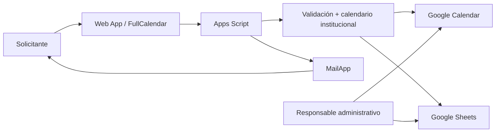

# Arquitectura técnica — Sala 13

## Stack

- **Frontend:** HTML, CSS, JavaScript y FullCalendar 6, con vistas de agenda e interacción para nuevas reservas y su gestión.
- **Backend:** Google Apps Script, expuesto como aplicación web mediante `doGet` y llamadas de interfaz con `google.script.run`.
- **Persistencia:** Google Sheets, con encabezados para datos de solicitud, estados, identificadores de eventos, confirmaciones y modalidad de recurrencia.
- **Agenda:** Google Calendar, utilizado para representar ocupación y coordinar eventos.
- **Notificaciones:** MailApp, correos operativos y enlaces de gestión.
- **Configuración:** Script Properties para datos propios del despliegue. No publicar credenciales ni IDs internos.

## Capacidades presentes en el código

| Módulo | Funciones representativas |
|---|---|
| Inicialización y configuración | `doGet`, `ensureSetup_`, `configurarSala13` |
| Lectura de agenda | `getAppData`, `getFutureReservations` |
| Alta | `createReservation`, `validateReservation_` |
| Fechas/recurrencia | `buildDailySlots_`, `buildReservationSchedule_`, `normalizeWeekdays_` |
| Edición | `getReservationForEdit`, `updateReservation` |
| Baja | `requestCancellation`, `cancelReservation` |
| Confirmación previa | `procesarRecordatoriosSala13`, `confirmReservationFromReminder` |
| Comunicaciones | `sendReminderEmail_`, `sendConfirmation_` |

## Modelo lógico

## Reglas de negocio destacables

- Validar horario de apertura, cierre y días restringidos.
- Limitar asistentes y número de fechas/ocurrencias en una solicitud.
- Considerar feriados, asuetos y restricciones institucionales.
- Evitar ocupaciones incompatibles con el calendario.
- Mantener identificadores de evento vinculados a registros.
- Permitir acciones de seguimiento y gestión mediante código/token de enlace.

## Consideraciones de seguridad y mantenimiento

La versión compartida no contiene bases de datos reales, registros de asistentes ni credenciales. La URL del despliegue que estaba fijada en código se sustituyó por `ScriptApp.getService().getUrl()`, que obtiene la URL del despliegue activo. Las configuraciones de permisos, disparadores de recordatorio y cuentas de Google deben ser gestionadas por el administrador del entorno.

**Limitación de esta documentación:** no se realizaron pruebas automáticas sobre un despliegue aislado para este portfolio. El repositorio permite inspección técnica, no garantiza instalación plug-and-play.
